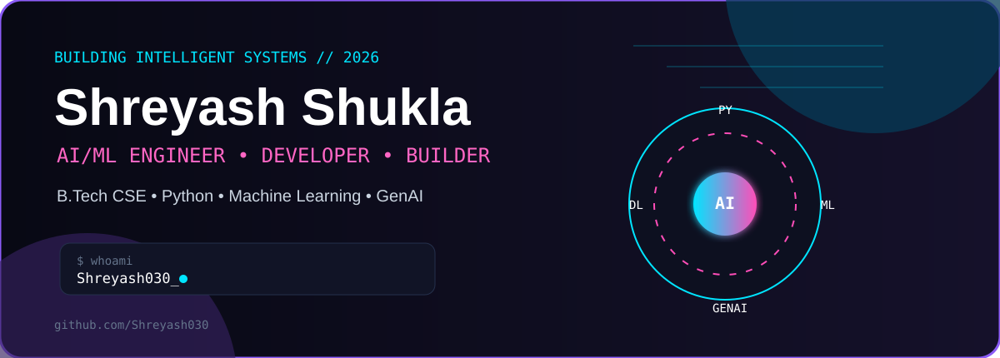
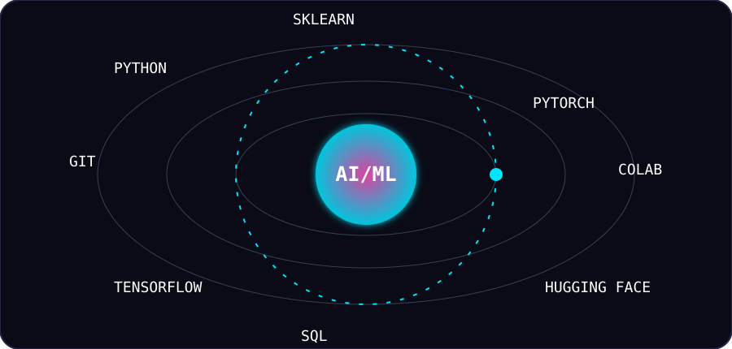
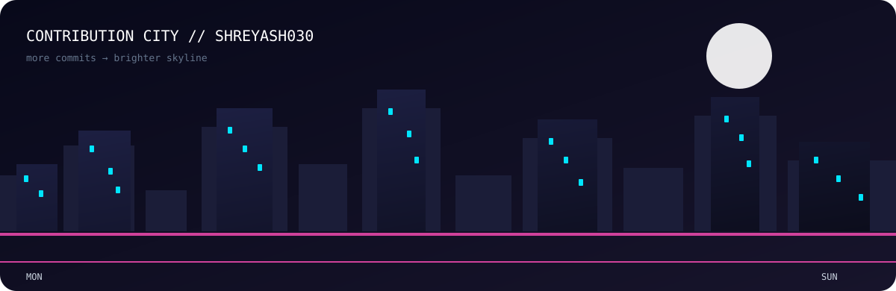
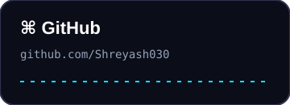
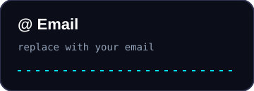

# 👋 Shreyash Shukla

<p align="center">
  
</p>

<p align="center">
  <b>B.Tech CSE • AI/ML Engineering</b><br>
  Building intelligent systems, experimenting with ML, and turning ideas into working projects.
</p>

<p align="center">
  <a href="https://github.com/Shreyash030"></a>
  <a href="https://www.linkedin.com/in/shreyash435/"></a>
  <a href="mailto:shreyashshukla801@gmail.com"></a>
</p>

---

## 🧠 What I Build

- 🤖 Machine-learning and AI experiments
- 📊 Data-driven applications and dashboards
- ⚙️ Python-based automation and developer tools
- 🌐 Full-stack projects with AI features
- 🔬 Practical experiments with computer vision, NLP and intelligent systems

## 🛠️ Tech Orbit

<p align="center">
  
</p>

**Core:** Python · C/C++ · SQL · Git · GitHub  
**AI/ML:** NumPy · Pandas · scikit-learn · TensorFlow · PyTorch · Hugging Face  
**Tools:** Jupyter · Google Colab · VS Code · Kaggle  
**Currently exploring:** Generative AI · Computer Vision · Edge AI · AI agents

---

## 🚀 Featured Projects

| Project | What it does | Stack |
|---|---|---|
| **AI/ML Projects** | Practical machine-learning experiments and models | Python · ML |
| **Campus / Student Tools** | Useful applications for college workflows | Python · SQL · Web |
| **Edge AI Experiments** | Exploring AI on compact/edge hardware | Python · C/C++ · Edge AI |

> Replace the three rows above with your real repositories when you are ready. The layout is already prepared for them.

---

## 📊 GitHub Dashboard

<p align="center">
  
  
</p>

<p align="center">
  
</p>

## 🏙️ Contribution City

<p align="center">
  
</p>

## 📈 What I'm Learning

```text
Machine Learning       ████████████████░░░░  80%
Deep Learning          ██████████████░░░░░░  70%
Data Science           ███████████████░░░░░  75%
Generative AI          ████████████░░░░░░░░  60%
Systems / OS           ███████████░░░░░░░░░  55%
```

## 🎯 Current Focus

> **Learn → Build → Test → Deploy → Repeat**

I'm focused on turning classroom concepts into practical projects and building a strong AI/ML engineering portfolio.

---

## 🌐 Connect With Me

<p align="center">
  <a href="https://github.com/Shreyash030">
    
  </a>
  &nbsp;
  <a href="https://www.linkedin.com/">
    
  </a>
  &nbsp;
  <a href="mailto:your-email@example.com">
    
  </a>
</p>

<p align="center">
  <sub>Designed as an animated GitHub profile • Shreyash030</sub>
</p>
